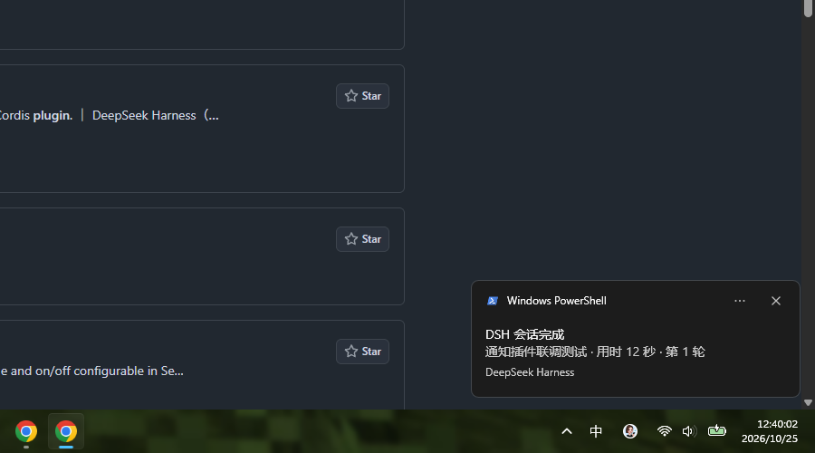

# dsh-session-notifier

**中文** | [English](README.en.md)

[](https://github.com/deepseek-ai/deepseek-harness)
[](#兼容性)
[](LICENSE)
[](https://github.com/topics/dsh-plugin)

DSH 宿主侧插件：**每当一轮会话回复结束，在 Windows 11 右下角弹出系统通知**，作用类似 Claude Code / Codex 的完成提示。默认只有 DSH 不在前台时才提示，避免盯着屏幕时被打扰。



> 上图为插件真实代码路径（`apply` → `turn/end` → `notify.ps1`）弹出的通知，2026-10-25 在本机实测。

## 为什么需要它

长任务跑起来以后，人通常会切到别的应用；DSH 这一轮结束、等你下一步输入时，没有任何提示。这个插件把 DSH 的 `turn/end` 事件变成一条 Windows 原生通知，带上会话标题、用时和轮次。

- **零运行时依赖**：没有 npm 依赖、不需要 BurntToast、不写注册表。
- **不打扰**：DSH 在前台时自动跳过。
- **不刷屏**：1.2 秒去抖，下一轮 `turn/start` 会取消上一条待发通知。
- **不炸子代理**：默认忽略 subagent 会话。
- **生命周期干净**：定时器/子进程都由 `ctx.effect` 清理。

## 特性

| 能力 | 行为 |
| --- | --- |
| 完成通知 | 监听 `session/event` → `turn/end`；默认 `completed` 与 `error` |
| 标题 | 取 `session/title`；没有标题时退回工作目录名 |
| 正文 | 会话标题 · 用时 · 第 N 轮；出错时显示错误摘要 |
| 前台策略 | 前台窗口属于 `DeepSeek Harness` 时不弹 |
| 去抖 | 1.2 秒；期间收到 `turn/start` 则取消 |
| 子代理 | 默认不通知；`notifySubagents: true` 打开 |
| 原生 Toast | WinRT `ToastNotificationManager`；不可用时降级 `NotifyIcon` 气泡 |
| 中文安全 | payload 用 base64(UTF-8 JSON)；中文/emoji 不经过代码页 |
| 配置 | 15 个可选键，见[配置](#配置) |

## 兼容性

| 项 | 值 |
| --- | --- |
| DSH | `0.2.1-rc.3`（实测；`dsh.compatibility` 已声明） |
| 系统 | Windows 11；依赖自带的 Windows PowerShell 5.1 |
| Node | 20+（DSH 自带运行时） |
| 其他平台 | 插件自动不激活 |

## 安装

### 从 GitHub 安装（非桌面 profile，推荐）

```powershell
dsh plugin --profile <profile> add github:LeeeWM/dsh-session-notifier
dsh --profile <profile> --dump-config | Select-String "dsh-session-notifier"
```

适用于 `web` / `headless` / `tui` 等非 desktop profile。

### 桌面端

Desktop profile 由 Electron 独占管理，CLI 会拒绝安装。请走 UI：

1. `git clone https://github.com/LeeeWM/dsh-session-notifier.git`
2. **Plugins → Add plugin → Install a third-party plugin**；
3. 填克隆目录的绝对路径 → **Install → Enable now**。

> 如果你的 Plugins UI 支持直接填 GitHub 包名，也可以尝试 `github:LeeeWM/dsh-session-notifier`；本仓库文档以“目录安装”为准。

### 本地开发

```powershell
# 桌面端：Plugins → Add plugin → 第三方插件 → 填插件目录绝对路径
# 非桌面 profile：
dsh plugin --profile <profile> add "C:\path\to\dsh-session-notifier"
```

本地目录是 `link:` 安装：改完 `index.js` / `notify.ps1` 后，需要禁用再启用插件（或重启 DSH）才加载新模块。

> **从旧包名升级**：早期版本包名是 `@local/dsh-session-notifier`。本版本已改为公开包名 `dsh-session-notifier`；请先在 Plugins 里 Remove 旧插件，再按上面的方式重新安装。

## 配置

`config` 全部可选；省略即使用默认值。**整行替换**：覆盖时把需要的键写全。

| 键 | 默认 | 说明 |
| --- | --- | --- |
| `enabled` | `true` | 总开关；`false` 时插件不注册任何监听 |
| `notifyOn` | `'completed-and-error'` | `'completed'` / `'completed-and-error'` / `'all'`（含 aborted、blocked、max-tokens） |
| `onlyWhenUnfocused` | `true` | DSH 在前台时不弹 |
| `sound` | `true` | 播放系统通知音（Toast 的 `<audio>`；balloon 用 `SystemSounds`） |
| `language` | `'zh'` | 内置文案语言：`'zh'` / `'en'` |
| `debounceMs` | `1200` | 去抖窗口；期间收到 `turn/start` 则取消 |
| `minTurnDurationMs` | `0` | 短于该时长的轮次不通知 |
| `notifySubagents` | `false` | 是否也通知子代理会话 |
| `dshProcessNames` | `['DeepSeek Harness']` | 判定“DSH 在前台”的进程名（不区分大小写，可写多个） |
| `mode` | `'auto'` | `'auto'` / `'toast'` / `'balloon'` |
| `aumid` | `''` | 已注册的 AppUserModelID；默认借用 Windows PowerShell 的 AUMID |
| `logFile` | `''` | `notify.ps1` 的诊断日志路径（UTF-8）；排查“没弹”时打开 |
| `timeoutMs` | `20000` | 通知进程超时被杀 |
| `dryRun` | `false` | 只把 payload 打到控制台，不弹通知（测试用） |
| `appName` | `'DeepSeek Harness'` | 通知里的归属名称 |

### 自定义配置

插件行的默认配置由 bundle 层提供。要改配置，在 **机器级用户层** `$DSH_HOME/cordis.patch.yml`（本机 `C:\Users\Lenovo\.dsh\cordis.patch.yml`）追加一行整行覆盖，例如：

```yaml
- id: dsh-session-notifier
  name: dsh-session-notifier
  config:
    enabled: true
    notifyOn: completed-and-error
    onlyWhenUnfocused: false
    sound: true
    language: zh
    debounceMs: 800
    notifySubagents: false
    mode: auto
    logFile: 'C:\Users\Lenovo\.dsh\logs\dsh-session-notifier.log'
```

> 不要在 `~/.dsh/profiles/desktop/` 里手改 `package.json` / `cordis.patch.yml`（桌面 profile 由 Electron 独占管理）。临时调试可用 `dsh --profile <test> --patch <overlay.yml>`。

## 工作原理

```
DSH session ──turn/start──▶ 记录开始时间，取消待发通知
            ──session/title▶ 缓存会话标题
            ──turn/end────▶ 过滤（子代理 / reason / 最短时长）
                             └─ 1.2s 去抖
                                 └─ spawn powershell.exe notify.ps1
                                     ├─ 前台是 DSH？→ 跳过
                                     └─ WinRT Toast → 失败则 balloon
```

- 事件 API：`ctx.on('session/event', (session, event) => …)`（与官方 `dsh-session-persistence-jsonl` 相同的监听方式）。
- 通知投递：`notify.ps1` 由 Windows PowerShell 5.1 执行；payload 用 **base64(UTF-8 JSON)** 通过 argv 传入，中文/emoji 不经过代码页。
- 本插件**不 import 任何 `@deepseek-ai/*` 包**，只用 Node 内置模块，因此本地 `link:` 安装不依赖 DSH 安装目录的模块解析。

## 文件

| 文件 | 作用 |
| --- | --- |
| `index.js` | 宿主插件入口：配置、事件监听、去抖、调用通知脚本 |
| `notify.ps1` | Windows 通知投递：前台检测、WinRT Toast、balloon 兜底、退出码 |
| `cordis.patch.yml` | 插入插件行（`id: dsh-session-notifier`，`name` 与包名一致） |
| `package.json` | `dsh.bundle.patch`、`dsh.compatibility`、`files` 白名单、脚本 |
| `locale/{zh,en}.json` | Plugins 页标题/描述 |
| `icon.svg` | 插件图标 |
| `test/mock-apply.mjs` | 离线 mock 宿主测试（不弹通知） |
| `test/live-smoke.mjs` | 真实弹一条通知的联调脚本 |
| `docs/toast-*.png` | 实测截图证据 |
| `README.md` / `README.en.md` | 中文 / English 文档 |
| `CHANGELOG.md` / `SECURITY.md` / `LICENSE` | 变更记录 / 安全策略 / MIT 许可 |

## 开发与验证

```powershell
npm run check                 # node --check index.js
npm test                      # 10 个离线 mock 宿主检查
npm run test:live             # 真实弹一条通知
```

静态检查：

```powershell
node -e "JSON.parse(require('fs').readFileSync('package.json','utf8')); console.log('json ok')"

# PowerShell 语法（Windows PowerShell 5.1）
$t=$null;$e=$null
[void][System.Management.Automation.Language.Parser]::ParseFile((Resolve-Path 'notify.ps1').Path,[ref]$t,[ref]$e)
"ps errors: $($e.Count)"
```

mock 覆盖：监听注册、禁用、标题/时长/轮次、去抖取消、子代理过滤、`notifyOn`、重复 `turn/end`、目录名回退、异步标题刷新、卸载清理。

### 用一次性 profile 做真实加载验证

```powershell
dsh --profile notifier-test --from-default-profile headless --dump-config
dsh plugin --profile notifier-test add "C:\path\to\dsh-session-notifier"
dsh --profile notifier-test --dump-config   # 出现 "# == dsh-session-notifier"
dsh plugin --profile notifier-test remove dsh-session-notifier
```

## 排查

| 现象 | 处理 |
| --- | --- |
| 完全没通知 | 看 Windows 设置 → 系统 → 通知 是否关闭 / 勿扰；先设 `onlyWhenUnfocused: false`；再设 `logFile` 看 `notify.ps1` 日志 |
| DSH 在前台时不弹 | 这是默认行为；要始终提示就设 `onlyWhenUnfocused: false` |
| 来源标签显示 “Windows PowerShell” | Toast 借用的是系统已注册的 PowerShell AUMID；如需自定义，注册 AppUserModelID 后填 `aumid`（非微软文档保证行为） |
| 子代理任务不弹 | 默认 `notifySubagents: false`；需要时打开（可能一次任务弹多条） |
| 通知太多 | 调大 `minTurnDurationMs` / `debounceMs`，或 `notifyOn: 'completed'` |
| 想看插件是否加载 | 启动日志出现 `[dsh-session-notifier] loaded (…)` |

调试时设置环境变量 `DSH_SESSION_NOTIFIER_DEBUG=1`，会在 stderr 打印实际 payload 与 PowerShell PID。

## 已知限制

- 仅 Windows（`process.platform === 'win32'`），其他平台插件自动不激活。
- 通知依赖 Windows PowerShell 5.1（Win11 自带）；无 `pwsh`、无 BurntToast 也能用。
- 勿扰 / 通知总开关关闭时，Toast 可能被系统静默丢弃，脚本无法检测；可用 `mode: 'balloon'` 换通道。
- Toast 约 5 秒后自动消失；不实现点击跳转/聚焦 DSH。
- 通知正文包含会话标题（本地显示，不联网）。
- 子代理默认不通知；多会话并行时按会话分别通知。
- 使用 `session/title` 作为标题；若会话从未生成标题，则退回目录名。
- **goal / 自动续跑**：去抖只覆盖 1.2 秒内立刻开始的下一轮；goal 续跑如果先 `await session/flush` 或等待子代理超过该窗口，会先提示“完成”再继续跑。DSH 目前没有公开的 “session idle” 事件（最接近的是 `agent/status === 'idle'`），本插件未用 `agent/status` 做门控；如需更严格可调大 `debounceMs` 或暂时关闭 goal。

## 安全

- 插件只读取 `session/title`、`session/header.cwd`、`turn/end`、`session/disposed` 事件。
- 只启动本地 `powershell.exe`（`-NoProfile -NonInteractive -WindowStyle Hidden`），不联网、不读取凭据、不做 shell 字符串拼接（参数走数组传递）。
- 运行时不需要 GitHub token 或任何账号数据；可选的 `logFile` 只包含通知文案。
- 漏洞报告见 [SECURITY.md](SECURITY.md)。

## 卸载

桌面端：**Plugins → dsh-session-notifier → Remove**。

非桌面 profile：

```powershell
dsh plugin --profile <profile> remove dsh-session-notifier
dsh --profile <profile> --dump-config | Select-String "dsh-session-notifier"
```

## License

[MIT](LICENSE) © 2026 [LeeeWM](https://github.com/LeeeWM)
